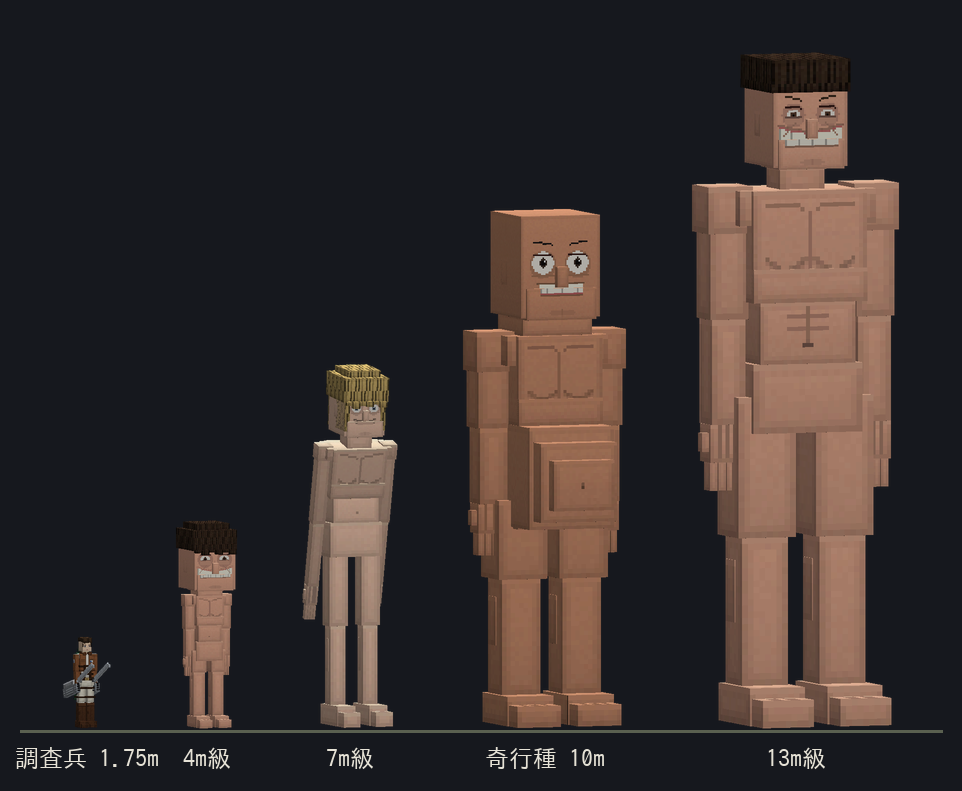
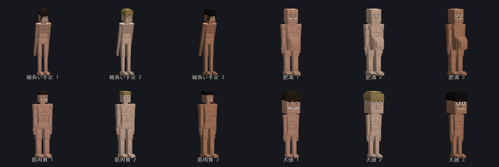
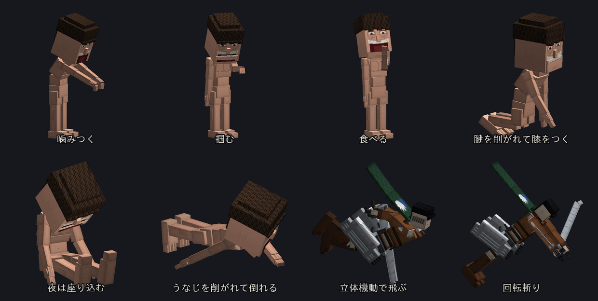
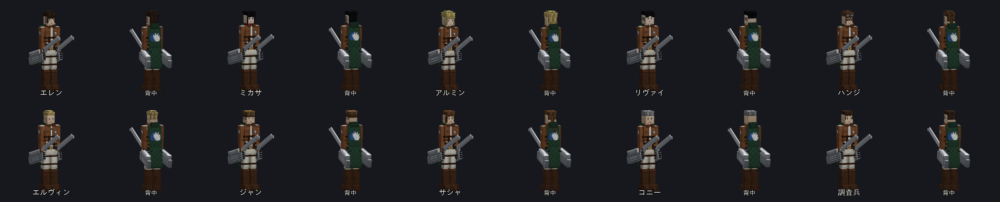

# 進撃の巨人 アドオン (Attack on Titan Add-on)

Minecraft **統合版 (Bedrock Edition)** 用の**非公式ファンメイド**・アドオンです。
立体機動装置で巨人の間を飛び回り、**うなじ**を削いで倒す —— その遊びを統合版で再現します。



- 対応バージョン: **Minecraft Bedrock 1.21.30 以降**
- 使用 API: `@minecraft/server 1.13.0`（安定版。**ベータ API の ON は不要**）/ `@minecraft/server-ui 1.2.0`
- 言語: 日本語 / English（ゲームの言語設定に追従）
- 公式の画像・音声・音楽は使っていません。モデル・テクスチャ・効果音はすべてプログラムで作っています。
  個人で遊ぶためのファンメイドです（マーケットプレイス等での配布はできません）

---

## 導入

1. `dist/AttackOnTitan_v1.0.0.mcaddon` を開いて Minecraft に取り込む
2. ワールド設定で **ビヘイビアーパック** と **リソースパック** の両方を有効化
3. 初めて入ると **調査兵団の手帳** が配られます。右クリックで操作説明・巨人図鑑、
   「装備の支給を受ける」で立体機動装置・刃・ガスなど一式がもらえます（1 人 1 回。クリエイティブは何度でも）

すぐ試すなら（チート ON のワールドで）:

```
/scriptevent aot:kit       装備一式をもらう（何度でも）
/scriptevent aot:gas       ガスを満タンにする
/scriptevent aot:journal   手帳を開く
```

巨人と調査兵団はクリエイティブのインベントリにスポーンエッグがあります。

---

## 操作

立体機動装置は **脚** に装備し、**刃（超硬質スチールの刃）** を手に持ちます。

| 操作 | 効果 |
|---|---|
| **右クリック長押し** | 視線の先（45m）へアンカーを撃ち込み、押している間ワイヤーを巻き取って飛ぶ。巨人に刺せば、巨人が動いても刺さったまま |
| **離す** | ワイヤーを切り離す。勢いはしばらく残り、弧を描いて飛べる |
| **空中でジャンプ** | ガスを噴いて視線の方向へ加速 |
| **空中でスニーク** | 回転斬り。周りを斬り、うなじが範囲内なら削ぐ |
| **攻撃** | 斬撃。うなじに当たれば討伐 |
| 巨人に刺して巻き取り、うなじの脇を抜ける | **自動でうなじを削ぐ**（スマホでも狙いやすい） |
| 掴まれた時に **スニーク** | 指を斬って脱出（ガス 10）。刃で 3 回斬っても抜けられる |
| 雷槍を右クリック | 雷槍を撃つ。刺さって 1.2 秒後に爆発 |
| ガスボンベを使う | ガスを満タンに |
| 信煙弾を右クリック／スニーク＋右クリック | 煙を上げる／色を変える（緑・赤・黒・黄） |

画面下に **ガス・刃の残り・替え刃の数・アンカーまでの距離・討伐数** が出ます（手帳の設定で消せます）。

### うなじの判定

* うなじは巨人の首の後ろ。体型ごとに位置を測ってあり、**膝をつくと下がり、座り込むともっと下がる**
* **後ろか上から**斬らないと届かない（正面から顔ごしには斬れない）
* **勢いが要る**: 速く飛んでいる時、ワイヤーを使った直後、回転斬り、巻き取りで脇を抜けた時は一撃で討伐。
  地上で立ち止まって斬ると「浅い！」（最大体力の 40% で、しばらく再生しない）
* 足首（腱）を斬ると 30% で**膝をつく**（6 秒。うなじが下がる）。目を斬ると**目を潰す**（6 秒、両手で顔を覆う）
* うなじ以外の傷は **3 秒後から蒸気を上げて再生**する（体へのダメージはもともと 1/4）

### 消耗と補給

* **ガス**: アンカー・巻き取り・噴射・回転斬りで減る。**ガスボンベ**で満タン
* **刃**: 斬るたびに刃こぼれし、限界が来ると**替え刃**に自動で交換（刃を捨てる音と動き付き）。替え刃が無いと折れる
* **着地**: 落ちる直前にガスを噴いて衝撃を殺すので、立体機動装置とガスがあれば落下ダメージを受けない

---

## 巨人



| 巨人 | 全高 | 体力 | 特徴 |
|---|---|---|---|
| 4m級 | 4m | 50 | 掴まずに噛みつく。地上からでもうなじに届く |
| 7m級 | 7m | 110 | 手が届けば掴んで口へ運ぶ。上半身の前に浮くと腕で払う |
| 13m級 | 13m | 220 | 歩くたびに地面が揺れる。うなじまでは立体機動が要る |
| 奇行種 | 10m | 160 | 突然跳びかかり、全力疾走する。着地で周りを吹き飛ばす |

* 見た目は **体型 4 種（細長い手足・肥満・筋肉質・大頭）× 顔と肌 3 種（耳まで裂けた笑い・瞳の小さな無表情・
  開いた口）= 12 通り**。同じ見た目でも級ごとに大きさが違います
* 人（プレイヤー・村人・行商人・調査兵団）だけを狙います。素材は落とさず、倒すと**前のめりに倒れて
  4 秒蒸気を上げて消え**、経験値になります
* **夜は日光が無いので座り込んで動かない**。攻撃すると起きます
* 掴まれると 1.5 秒で口へ運ばれ、2.5 秒で噛まれます（大ダメージ）。手帳の設定で掴みを止められます
* 昼の平原・森・サバンナ・タイガ・草原に自然に湧きます（手帳の設定で止められます。スポーンエッグは常に使えます）
* 葉っぱは歩くと壊れます



---

## 調査兵団



エレン・ミカサ・アルミン・リヴァイ・ハンジ・エルヴィン・ジャン・サシャ・コニーと調査兵。
身長は公式の設定に合わせ、髪型・瞳の色・ミカサの赤いマフラー・リヴァイのクラバット・ハンジの眼鏡と
ゴーグル・エルヴィンのループタイまで作ってあります。全員が**上着・自由の翼のマント・立体機動装置・両手の刃**を
身に着けています。

* 巨人を見つけると、自分で**立体機動の攻撃**を仕掛けます: 巨人の肩にアンカーを刺す → ワイヤーで飛ぶ →
  うなじの後ろへ回り込んで回転斬り → 離脱して着地
* うなじを削ぐ成功率はキャラごと（リヴァイ 97%・ミカサ 92% は二連撃、アルミン 40%）。失敗すると
  巨人に捕まることも（プレイヤーが助けられます）
* **エルヴィン**が近くで巨人と戦うと「心臓を捧げよ！」— 周りの兵士とプレイヤーに力と速さ
* **パンかベイクドポテト**を渡すと仲間になって付いてきます（サシャはベイクドポテトだけ）。
  仲間を右クリックすると待機

---

## アイテムとレシピ

| アイテム | レシピ（作業台） |
|---|---|
| 超硬質スチール ×2 | 鉄インゴット 4 ＋ 石炭（木炭） 1（十字） |
| 超硬質スチールの刃 | 超硬質スチール 4 ＋ 棒 2 |
| 替え刃 ×4 | 超硬質スチール 2（縦） |
| 立体機動装置（脚） | 超硬質スチール 4 ＋ リード 2 ＋ ピストン |
| ガスボンベ ×2 | 鉄インゴット 4 ＋ 火薬 |
| 雷槍 ×2 | 超硬質スチール 2 ＋ TNT |
| 調査兵団の上着とマント（胴） | 革 8 ＋ 緑の染料 |
| 兵団のブーツ（足） | 革 4 ＋ 茶色の染料 |
| 信煙弾 | 鉄インゴット 2 ＋ 火打石と打ち金 ＋ 火薬 |
| 調査兵団の手帳 | 本 ＋ 緑の染料 |

上着・立体機動装置・ブーツは、着るとプレイヤーの体に**3D の制服と装置**が付きます（マントは走ると後ろへ流れ、
空中では大きく翻ります）。刃は**両手に一振りずつ**持ちます。

---

## 作り込み

* **プレイヤーの全身モーション**（`playanimation`。player.entity.json は上書きしないので他のアドオンと
  競合しにくい）: 刃の構え、立体機動の**飛行姿勢**（体を倒し、脚を揃え、刃を後ろへ流す）、回転斬り、
  うなじ斬り、ガス噴射、掴まれ、刃の交換、雷槍の発射。一人称では体は動かさず腕だけ控えめに動きます
* **ワイヤー**は 1 本を数個の細長いパーティクルで描くので、45m 先まで途切れず、毎 tick 付いてきます
* **巨人のアニメーション**: 待機（口がゆっくり開閉し首が傾ぐ）・大股の歩き（大きいほど歩幅が広い）・奇行種の
  疾走・噛みつき・払い・掴み・食べる・膝をつく・座り込む・目を覆う・跳躍・倒れる。食べる時と目を覆う時の
  腕は、**体型ごとに手が口／目に届く角度を数値で解いて**あります
* **パーティクル 17 種**: ワイヤー・蒸気（再生と蒸発）・ガス・火花・斬撃・閃光・血しぶき（すぐ蒸気になる）・
  煙（信煙弾）・土煙・瓦礫・炎・衝撃の輪・スピードライン
* **効果音 20 種を合成**（素材音源なし）: アンカー射出・刺さる音・巻き取りのモーター・ガスの噴射・
  刃の風切り・斬撃・うなじを削ぐ音・刃の交換・刃が折れる音・巨人の足音（地響き）・うめき声・噛みつき・
  倒れる音・蒸気・雷槍の発射と導火と爆発・信煙弾・討伐の合図
* **画面揺れ**: 巨人の足音（大きいほど遠くまで）・倒れた時・雷槍の爆発

---

## 開発者向け

すべて `tools/aot/` の Python スクリプトから**生成**されます。`packs/aot_*` を直接編集せず、
生成スクリプトを編集して再ビルドしてください。

```bash
./build_aot.sh                              # 生成 → 挙動テスト → 参照検証 → dist/ に書き出し
python3 tools/aot/test_aot.py               # 偽の世界で立体機動・うなじ・掴み・雷槍・兵士・昼夜を実際に動かす
python3 tools/aot/validate_aot.py           # 参照切れ（ジオメトリ・テクスチャ・アニメ・効果音・翻訳キー）の検査
python3 tools/aot/aot_preview.py titans soldiers gear faces poses:bighead   # モデルと姿勢を PNG に描く
python3 tools/aot/gen_aot_docs.py           # README の画像
```

| ファイル | 内容 |
|---|---|
| `tools/aot/DESIGN.md` | 設計メモ（操作・うなじの判定・巨人の級） |
| `tools/aot/aot_models.py` | 巨人 4 体型・調査兵団 10 人・着る装備・刃・雷槍のモデル。共有の `rig.py`（身長と等身から骨格）を使う |
| `tools/aot/aot_paint.py` | 巨人の顔（笑い・歯茎・口の中）、自由の翼の紋章、制服の細部の描画 |
| `tools/aot/gen_aot_anim.py` | 巨人と兵士のアニメーション、刃の持ち方（超次元の `hd_holds` で握りが拳に来るよう逆算）、プレイヤーの全身モーション |
| `tools/aot/gen_aot_particles.py` / `gen_aot_sounds.py` | パーティクルとスプライト、効果音の合成 |
| `tools/aot/gen_aot_packs.py` | アイテム・エンティティ・スポーンルール・レシピ・クライアント定義・アイコン |
| `tools/aot/aot_lang.py` | 日本語と英語の文言（スクリプトの翻訳キーも全部ここ） |
| `packs/aot_BP/scripts/` | `odm.js`（立体機動）・`titans.js`（うなじ・再生・掴み・昼夜）・`soldiers.js`（兵士の立体機動）・`spear.js`（雷槍・信煙弾）・`ui.js`（手帳と HUD） |

挙動の調整値（巻き取りの強さ・最高速・ガスの消費・うなじの判定の広さなど）は
`packs/aot_BP/scripts/config.js` の `TUNE` にまとまっています。

> 実機（Minecraft）での確認はまだです。巻き取りの速さや飛び方の手触りは、実機で試しながら
> `TUNE` を調整する前提で作ってあります。
