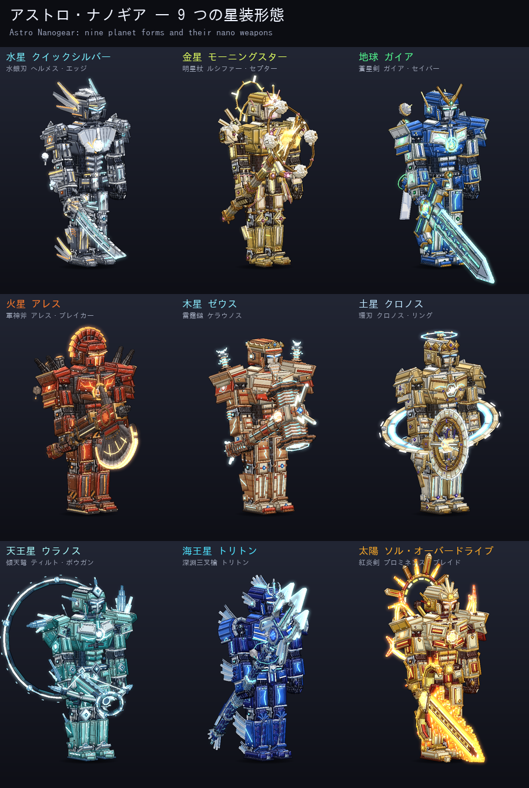
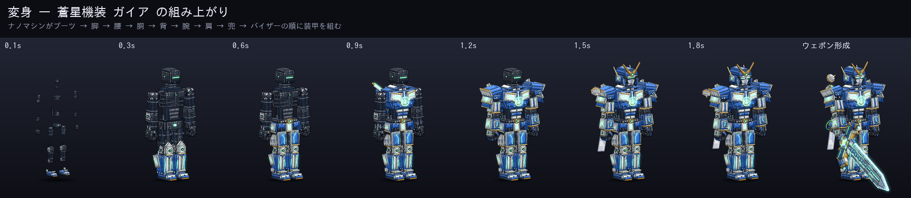
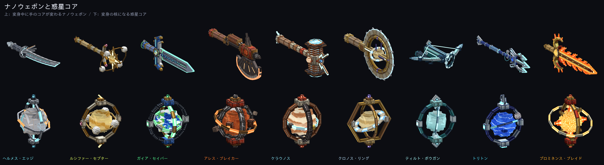
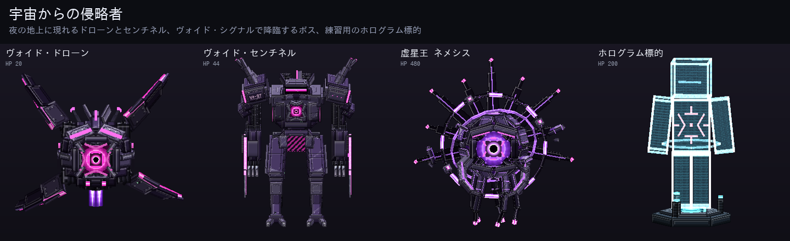
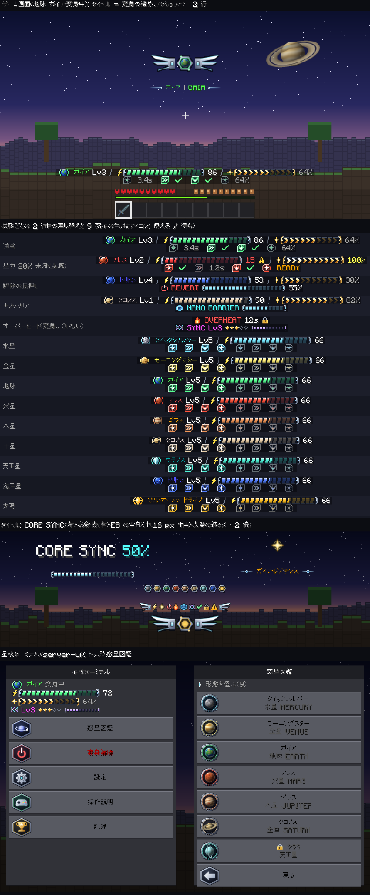
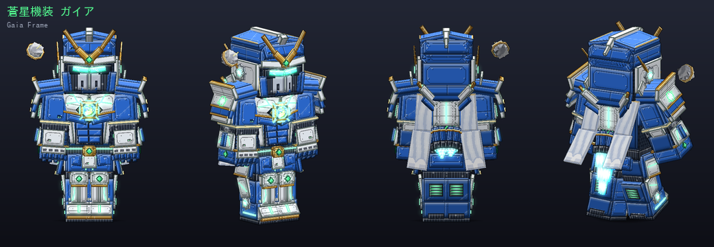

# アストロ・ナノギア (Astro Nanogear)

> このリポジトリには **怪獣8号 アドオン**（[README.md](README.md)）と **超次元バトルアーツ**（[README_HYPERDIM.md](README_HYPERDIM.md)）も入っています。

Minecraft **統合版 (Bedrock Edition)** 用のオリジナル宇宙アドオンです。
惑星の力を宿した **星核（変身の核）** から噴き出すメカ・ナノマシンが全身装甲と専用ナノウェポンを組み上げ、
水星から海王星、そして太陽まで **9 つの形態** で、惑星の力と技術を融合した技を使って戦います。

- 対応バージョン: **Minecraft Bedrock 1.21.30 以降**
- 使用 API: `@minecraft/server 1.13.0`（安定版。ベータ API の ON は不要）/ `@minecraft/server-ui 1.2.0`
- 言語: 日本語 / English





---

## 導入

1. `dist/AstroNanogear_v1.1.0.mcaddon` を開いて Minecraft に取り込む
2. ワールド設定で **ビヘイビアーパック** と **リソースパック** の両方を有効化
3. 初回参加時に **星核ターミナル** が配られます（右クリックで状態・惑星図鑑・設定・操作説明）

すぐ試すなら（チート ON のワールドで）:

```
/scriptevent astro:kit        全コアとターミナル・素材を一式
/scriptevent astro:target     目の前にホログラム標的（倒れない・DPS 表示）
/scriptevent astro:nova       超新星ゲージを満タン（必殺技の確認用）
/scriptevent astro:energy     星力を満タン
/scriptevent astro:sync       今の形態の同調率を Lv5 に
/scriptevent astro:boss       虚星王 ネメシスを呼ぶ
/scriptevent astro:revert     強制的に変身解除
```

---

## 操作

| 操作 | 効果 |
|---|---|
| 惑星コアを持って右クリック | **変身**（約 3 秒の変身演出。星力 30 以上が必要） |
| 攻撃 | 三段コンボ。三段目は形態ごとの追撃 |
| 右クリック | **惑星技** |
| ダッシュ中に右クリック | **機動技** |
| 空中で右クリック | **空中技** |
| スニーク＋右クリック（超新星ゲージ 100%） | **必殺**（ゲージ未満ならナノ・バリア） |
| 空中でジャンプ | スラスターで **二段ジャンプ** |
| 空中でジャンプ長押し | **ホバー**（星力を消費） |
| 空中でスニーク | **ブースト・ダッシュ** |
| 地上でスニークを素早く 2 回 | **回避ステップ**（直後に攻撃を受けると **ジャスト回避**） |
| スニークしたまま 2 秒静止 | **変身解除** |

### 星力・超新星ゲージ・同調率

- **星力**: 変身中は少しずつ減り、技やホバーでも減ります。0 になると強制解除され、20 秒の **オーバーヒート**（再変身不可）。変身していない間に回復し、敵を倒すと +5。
- **超新星ゲージ**: 攻撃を当てる・被弾する・ジャスト回避で溜まり、100% で必殺技。
- **同調率**: 形態ごとに Lv1〜5。戦うほど上がり、与ダメージ・最大星力・再使用時間が伸びます。

---

## 9 つの形態

| 形態 | ナノウェポン | パッシブ |
|---|---|---|
| **水星 クイックシルバー**（水銀機装 クイックシルバー） | 水銀刃 ヘルメス・エッジ | スピード II。疾走中は液体金属の残像が残り、残像に触れた敵を斬る |
| **金星 モーニングスター**（明星機装 モーニングスター） | 明星杖 ルシファー・セプター | 炎無効。殴ってきた相手を硫酸の毒で蝕む |
| **地球 ガイア**（蒼星機装 ガイア） | 蒼星剣 ガイア・セイバー | 再生。月の子機ルナ・ビットが近くの敵を自動で撃つ |
| **火星 アレス**（軍神機装 アレス） | 軍神斧 アレス・ブレイカー | 攻撃力アップ・炎無効。敵を倒すと雄叫びで周りの敵がすくむ |
| **木星 ゼウス**（雷帝機装 ゼウス） | 雷霆鎚 ケラウノス | 耐性。攻撃が当たるたびに静電気が溜まり、5 回目で近くの敵へ連鎖放電 |
| **土星 クロノス**（環帝機装 クロノス） | 環刃 クロノス・リング | 低速落下（水に浮くほど軽い）。環の欠片が体の周りを回り、触れた敵を削る |
| **天王星 ウラノス**（傾天機装 ウラノス） | 傾天弩 ティルト・ボウガン | 殴ってきた相手を凍えさせる。近くの敵の足が鈍る |
| **海王星 トリトン**（深淵機装 トリトン） | 深淵三叉槍 トリトン | 水中呼吸・コンジットパワー。水中か雨の中では与ダメージが上がる |
| **太陽 ソル・オーバードライブ**（恒星機装 ソル・オーバードライブ） | 紅炎剣 プロミネンス・ブレイド | 炎無効・再生・暗視。近くの敵を焦がすコロナをまとう |

### ☿ 水星 — クイックシルバー / QUICKSILVER

液体金属のナノマシン。ヘルメスの翼の兜と翼のブーツ。昼側の灼熱（橙）と夜側の極寒（シアン）を左右で塗り分ける。

| 技 | 名前 | 内容 | 再使用 |
|---|---|---|---|
| 惑星技 | **水銀閃** <br>`QUICKSILVER FLASH` | 前方 7m を一瞬で駆け抜け、通り道の敵を斬る。残った水銀が遅れて弾ける | 3.5 秒 |
| 機動技 | **ヘルメスの翼** <br>`WINGS OF HERMES` | 近くの敵の周りを三度跳び回り、そのたびに斬りつける | 4.5 秒 |
| 空中技 | **マーキュリー・レイン** <br>`MERCURY RAIN` | 宙で止まり、液体金属の針を前下方へ雨のように降らせる | 5.0 秒 |
| 必殺 | **近日点突破 ペリヘリオン・ドライブ** <br>`PERIHELION DRIVE` | 時を止め、光速で敵の周りを八度斬り抜ける。最後に昼側の灼熱と夜側の極寒が同時に炸裂する | 15.0 秒 |
| 三段目 | **水銀の飛沫** | 三段目で液体金属の刃が伸び、前方 4m を薙ぐ | — |

### ♀ 金星 — モーニングスター / MORNING STAR

明けの明星の女神。金とクリームの花弁のような腰の装甲、星の冠、肩から硫酸雲を噴く雲ポッド。

| 技 | 名前 | 内容 | 再使用 |
|---|---|---|---|
| 惑星技 | **硫酸雲 アシッド・ヴェール** <br>`ACID VEIL` | 硫酸雲の弾を放つ。着弾点に 4 秒残る黄色い雲が、中の敵を毒と鈍化で蝕む | 5.5 秒 |
| 機動技 | **逆行旋 レトログレード** <br>`RETROGRADE` | 金星の逆回転のように回りながら突進し、触れた敵を背後へ投げ飛ばす | 4.5 秒 |
| 空中技 | **温室熱波 グリーンハウス** <br>`GREENHOUSE` | 急降下し、着地点に 465℃ の熱の天蓋を広げる | 5.0 秒 |
| 必殺 | **明けの明星 モーニングスター** <br>`MORNING STAR` | 天に巨大な明星を灯し、星光の柱を降らせる。最後に硫酸の雨が降り注ぐ | 15.0 秒 |
| 三段目 | **星屑の花** | 三段目で星の花が咲き、周りの敵を灼く | — |

### ♁ 地球 — ガイア / GAIA

青と白の騎士型。緑に光る大陸の線、雲のような白いマント、肩の周りを回る月の子機（ルナ・ビット）。

| 技 | 名前 | 内容 | 再使用 |
|---|---|---|---|
| 惑星技 | **潮汐斬 タイダル・エッジ** <br>`TIDAL EDGE` | 月の引力で満ちる三日月の波を飛ばす。12m 進み、触れた敵を押し流す | 4.5 秒 |
| 機動技 | **磁気圏突撃 マグネトスフィア** <br>`MAGNETOSPHERE` | 磁気圏の盾をまとって突進する。突進中はほぼ無敵で、触れた敵を弾き飛ばす | 5.0 秒 |
| 空中技 | **月墜 ルナ・フォール** <br>`LUNA FALL` | ルナ・ビットを巨大化させて狙った地点へ落とす | 5.5 秒 |
| 必殺 | **ガイア・レゾナンス** <br>`GAIA RESONANCE` | 剣を大地に突き立て、地殻の柱を三重の輪で突き上げる。オーロラの幕が味方を癒やす | 15.0 秒 |
| 三段目 | **オーロラ斬** | 三段目でオーロラの斬撃が前方へ広がる | — |

### ♂ 火星 — アレス / ARES

重装の軍神。真紅と錆色の厚い装甲、スパルタ風の鶏冠の兜、大きな肩当て、背中を回る二つの衛星（フォボスとダイモス）。

| 技 | 名前 | 内容 | 再使用 |
|---|---|---|---|
| 惑星技 | **赤砂嵐 ダストストーム** <br>`DUST STORM` | 赤い砂嵐をまとう。3 秒間、周り 4m の敵を削り、視界を奪う | 5.5 秒 |
| 機動技 | **軍神突撃 ウォーパス** <br>`WARPATH` | 肩から突っ込み、前の敵をまとめて押し込んで打ち上げる | 4.5 秒 |
| 空中技 | **オリンポス・インパクト** <br>`OLYMPUS IMPACT` | 真下へ落ち、着地点の周りに溶岩の噴火口を六つ開く | 5.5 秒 |
| 必殺 | **恐怖と戦慄 フォボス＆ダイモス** <br>`PHOBOS & DEIMOS` | 二つの衛星を巨大な隕石にして続けざまに落とす。生き残った敵は恐怖ですくむ | 15.0 秒 |
| 三段目 | **杭打ち** | 三段目で斧の杭打ち機が火を噴き、地面ごと吹き飛ばす | — |

### ♃ 木星 — ゼウス / ZEUS

巨大なガス惑星の王。クリームと褐色の縞の重装甲、胸で渦巻く大赤斑のコア、肩のテスラコイル、王冠の兜。

| 技 | 名前 | 内容 | 再使用 |
|---|---|---|---|
| 惑星技 | **雷霆 ケラウノス** <br>`KERAUNOS` | 前方の敵に雷を落とし、最大 5 体まで連鎖させる | 5.0 秒 |
| 機動技 | **重力スイングバイ** <br>`GRAVITY SWING-BY` | 前方に重力の井戸を作って敵を一点に集め、その中を突き抜ける | 5.0 秒 |
| 空中技 | **大赤斑 グレートレッドスポット** <br>`GREAT RED SPOT` | 巨大な嵐の渦をまとって降り、周りの敵を吸い込んで雷で打つ | 6.0 秒 |
| 必殺 | **ガリレオの審判** <br>`GALILEAN JUDGEMENT` | イオ（噴火）・エウロパ（氷）・ガニメデ（重力）・カリスト（衝突）の四衛星を落とし、最後に極大の雷霆 | 15.0 秒 |
| 三段目 | **雷槌** | 三段目で鎚から落雷し、周りの敵を感電させる | — |

### ♄ 土星 — クロノス / KRONOS

環を従える時の王。淡い金とアイボリーの装甲、腰を斜めに回る大きな環、胸の六角形（北極の六角渦）、時計の文字盤の意匠。

| 技 | 名前 | 内容 | 再使用 |
|---|---|---|---|
| 惑星技 | **リング・ソー** <br>`RING SAW` | 環刃を投げる。12m 先で折り返して戻り、行きと帰りで敵を刻む | 4.0 秒 |
| 機動技 | **環転 リング・スライド** <br>`RING SLIDE` | 環に乗って地面を滑走し、通り道の敵を切り裂く | 4.5 秒 |
| 空中技 | **六角極渦 ヘキサゴン** <br>`HEXAGON` | 狙った地点に六角形の嵐を落とす。中の敵は 4 秒間鈍り、刻まれ続ける | 5.5 秒 |
| 必殺 | **クロノス・ホライズン** <br>`KRONOS HORIZON` | 時を止める時計の陣を広げ、止まった敵を巨大な環の一閃で両断する | 15.0 秒 |
| 三段目 | **環断** | 三段目で環刃が水平に広がり、周りを一周薙ぐ | — |

### ⛢ 天王星 — ウラノス / OURANOS

横倒しの氷の巨星。淡い青緑の鋭い装甲、肩の氷晶、背中で 98° 傾いて縦に回る環、ダイヤモンドの鶏冠。

| 技 | 名前 | 内容 | 再使用 |
|---|---|---|---|
| 惑星技 | **絶対零度矢 アブソリュート・アロー** <br>`ABSOLUTE ARROW` | 敵を貫く冷気の矢。当たった敵は凍りつき、着弾点に氷の棘が立つ | 3.0 秒 |
| 機動技 | **98° ロール** <br>`98° ROLL` | 横倒しに転がって避け、氷の分身を残す。次の惑星技は三本同時に撃つ | 3.5 秒 |
| 空中技 | **ダイヤモンド・レイン** <br>`DIAMOND RAIN` | 前方の広い範囲にダイヤモンドの雨を降らせる | 5.5 秒 |
| 必殺 | **アクシアル・ティルト** <br>`AXIAL TILT` | 重力の向きを 98° 傾けて敵を横へ放り出し、氷に閉じ込めてから粉々に砕く | 15.0 秒 |
| 三段目 | **氷晶散弾** | 三段目で至近距離へ氷晶の散弾を撃つ | — |

### ♆ 海王星 — トリトン / TRITON

深海の騎士。紺碧と藍の装甲に白い波頭のヒレ、腕と脛のヒレ、三叉の冠、生物発光のような水色の線。

| 技 | 名前 | 内容 | 再使用 |
|---|---|---|---|
| 惑星技 | **超音速の風 スーパーソニック** <br>`SUPERSONIC` | 秒速 600m の風の刃を突き出す。前方 14m を貫く | 4.0 秒 |
| 機動技 | **大暗斑 ダークスポット** <br>`DARK SPOT` | 暗い渦に飛び込んで 8m 先へ抜ける。残った渦が敵を引き込む | 5.0 秒 |
| 空中技 | **トリトンの逆行** <br>`RETROGRADE TRITON` | 槍を逆行する衛星に変えて真下へ投げ、着弾点に窒素の間欠泉を噴かせる | 5.5 秒 |
| 必殺 | **アビサル・テンペスト** <br>`ABYSSAL TEMPEST` | 巨大な渦潮と超音速の嵐で敵を巻き上げ、最後に大津波で押し潰す | 15.0 秒 |
| 三段目 | **波濤突き** | 三段目の突きで水の槍が 5m 先まで伸びる | — |

### ☉ 太陽 — ソル・オーバードライブ / SOL OVERDRIVE

恒星そのもの。白金と金の装甲、頭の後ろで回る棘のあるコロナの光輪、炎のようなプロミネンスのヒレ、胸で脈打つ核融合炉。

| 技 | 名前 | 内容 | 再使用 |
|---|---|---|---|
| 惑星技 | **ソーラー・フレア** <br>`SOLAR FLARE` | 前方の扇形を太陽フレアで焼き、目を眩ませる | 4.5 秒 |
| 機動技 | **コロナ・ドライブ** <br>`CORONA DRIVE` | コロナをまとって突進し、炎の軌跡を残す | 4.5 秒 |
| 空中技 | **プロミネンス・アーチ** <br>`PROMINENCE ARCH` | 紅炎のアーチを三本、前方へ叩きつける | 5.5 秒 |
| 必殺 | **スーパーノヴァ** <br>`SUPERNOVA` | 自らを恒星の核に変えて収縮し、超新星爆発で全てを吹き飛ばす | 15.0 秒 |
| 三段目 | **紅炎の弧** | 三段目で紅炎の弧が前方を焼き払う | — |

---

## 入手と進行

| 作るもの | 材料 |
|---|---|
| ナノマシン・セル ×2 | 鉄インゴット・レッドストーン・アメジストの欠片 |
| コア・フレーム ×1 | ナノマシン・セル・ガラス・ダイヤモンド |
| 星核ターミナル ×1 | 鉄インゴット・ナノマシン・セル・板ガラス |
| ヴォイド・シグナル ×1 | ナノマシン・セル・エンダーアイ・ダイヤモンドブロック |
| 水星核 マーキュリー・コア | ナノマシン・セル ×4・コア・フレーム・ネザークォーツ ×2・羽根 ×2 |
| 金星核 ヴィーナス・コア | ナノマシン・セル ×4・コア・フレーム・ブレイズパウダー ×2・グロウストーンダスト ×2 |
| 地球核 アース・コア | ナノマシン・セル ×4・コア・フレーム・エメラルド ×2・ラピスラズリ ×2 |
| 火星核 マーズ・コア | ナノマシン・セル ×4・コア・フレーム・マグマブロック ×2・レッドストーンブロック ×2 |
| 木星核 ジュピター・コア | ナノマシン・セル ×4・コア・フレーム・避雷針 ×2・銅ブロック ×2 |
| 土星核 サターン・コア | ナノマシン・セル ×4・コア・フレーム・時計 ×2・金インゴット ×2 |
| 天王星核 ウラヌス・コア | ナノマシン・セル ×4・コア・フレーム・氷塊 ×2・ダイヤモンド ×2 |
| 海王星核 ネプチューン・コア | ナノマシン・セル ×4・コア・フレーム・プリズマリンの欠片 ×2・オウムガイの殻 ×2 |
| 恒星核 ソル・コア | ナノマシン・セル ×4・コア・フレーム・太陽の欠片 ×2・金ブロック ×2 |

- 夜の地上に **ヴォイド・ドローン**・**ヴォイド・センチネル** が現れ、ナノマシン・セルを落とします。
- **ヴォイド・シグナル** を夜に使うとボス **虚星王 ネメシス** が降臨。倒すと **太陽の欠片** が手に入り、第 9 形態 **ソル** のコアを作れます。





---

## 作り込み

### 変身演出（約 3 秒）

1. 惑星コアが手から浮かび、リングが展開。演出カメラが斜め前から回り込む（設定で OFF にできる）
2. ナノマシンの奔流がコアから螺旋を描いて全身へ流れ込み、タイトルに `CORE SYNC 0% → 100%`
3. 装甲が **ブーツ → 脚 → 腰 → 胴 → 背 → 腕 → 肩 → 兜 → バイザー** の順に部位ごとにポップして組み上がる
   （粒の流れ込みと組み上がりの効果音が同じ瞬間に鳴る）
4. 手のコアがナノウェポンに変わり（刃が伸びる形成アニメ）、バイザーが点灯
5. 惑星ごとの締めの演出（水星は液体金属の残像、土星は地平線のような環の一閃、太陽はコロナの三重の輪…）と、
   紋章と形態名のカットイン。周りのプレイヤーにも見える

解除はスーツが逆順に分解され、ナノマシンがコアへ還ります。後から描画距離に入った人には組み上がりを
繰り返さないよう、組み上がり中／装着中／分解中でアイテムを分けています。

### 3D モデル

| 形態 | スーツ | ナノウェポン | コア |
|---|---|---|---|
| 水星 クイックシルバー | 515 キューブ | 117 キューブ | 65 キューブ |
| 金星 モーニングスター | 575 キューブ | 159 キューブ | 75 キューブ |
| 地球 ガイア | 409 キューブ | 127 キューブ | 67 キューブ |
| 火星 アレス | 506 キューブ | 141 キューブ | 74 キューブ |
| 木星 ゼウス | 538 キューブ | 144 キューブ | 57 キューブ |
| 土星 クロノス | 582 キューブ | 179 キューブ | 57 キューブ |
| 天王星 ウラノス | 552 キューブ | 136 キューブ | 67 キューブ |
| 海王星 トリトン | 573 キューブ | 167 キューブ | 57 キューブ |
| 太陽 ソル・オーバードライブ | 596 キューブ | 189 キューブ | 63 キューブ |

* **7 頭身**（v1.1）: 小さな兜・逆三角形の胸・くびれた腰・長い脚の、背丈 2 ブロックのヒーロー体型です。
  暗い機械の骨格（八角柱の関節ドラム・肘と膝と足首の油圧シリンダー・ケーブル・指の関節）の上に、
  縁取りのある多層の装甲板・リベット列・排気スリット・センサーの発光・アンテナやヒレを重ねています。
  背丈・頭の大きさ（背丈の 1/7）・胸と腰の幅の比・脚の長さ・細かい部品の割合（35% 以上）を検査で確かめています
  （`check_astro_suits.py`）。
* スーツは頭スロットのアイテムに付く全身のアタッチャブルで、ボーン名をプレイヤーと揃えて骨格に追従させています。
  変身中は **透明化（粒なし）** でプレイヤーの肌を隠し、スーツだけが見えます（解除の分解が終わると外れます。
  自分で飲んだ透明化のポーションは残します）。
* 斜めの装甲板・面取り・テーパー・環・翼・ヒレ・衛星などを回転キューブで組み、回る環や衛星、スラスターの炎、
  マントや花弁のスカートは別ボーンで常に動きます（空中で炎が伸び、疾走でマントがなびく）。
* テクスチャは 1024×1024 にセル塗りで直接描画: 面のグラデーション・照り返しと影の面取り・パネルライン・ボルト・
  警告ストライプや型番のデカール・六角メッシュのインナー・発光ライン（entity_emissive_alpha）・
  胸の星核にはその惑星の地表（大陸と雲、縞と大赤斑、暗斑、粒状斑…）。
* 一人称では兜と胴を隠し、装甲の腕だけが見えます。

### アニメーション

* 全身モーション 163 本（共通の変身・機動 15 本＋形態ごとの三段コンボと技のモーション）。武器が体にめり込まないよう、
  各形態の実際の武器の形で腕の角度を解いてから書き出しています（`gen_astro_anim.py --check`）。
* スーツの部位アニメ 72 本、ナノウェポン・コアの持ち方・待機・振り・形成 90 本、敵 22 本。

### エフェクト・パーティクル

* パーティクル 56 種（1024×1024 のスプライトアトラス）。全て白で描いてスクリプトから惑星の色で染めるので、
  同じ「衝撃波」が火星では真紅、海王星では水色に光ります。
* 技術的な魔法陣（目盛りと文字の円・六角陣）、9 惑星の紋章陣、ナノマシンの粒と奔流、光線、稲妻、隕石、
  オーロラの幕、渦、ブラックホール、硫酸雲、波頭、液体金属の滴、氷晶とダイヤ、紅炎…
* 1 tick に出す量に予算を設け、輪や線は 1 回の呼び出しで描く形状エミッタを使って通信量を抑えています。

### 効果音

素材ファイルを使わず、ノイズの帯域掃引・FM・包絡・残響で 62 種（153 ファイル、約 2MB）を合成。
変身の各段（起動・奔流・装甲の固定・バイザー・締め）、スラスター、斬撃と打撃、光線の溜めと発射、
雷・氷・風・水・重力・時間停止・超新星、UI、敵の駆動音と咆哮。

### UI

* **HUD**（アクションバー 2 行）: カスタムグリフ（`font/glyph_EA.png` と `glyph_EB.png`）で描いた惑星の紋章・
  星力バー（形態の色、20% 未満で赤く点滅）・超新星バー（満タンで金と白が流れる）・4 つの技のアイコンと再使用時間。
  解除の長押し・バリア・オーバーヒート中は 2 行目が状態表示に変わります。
* **星核ターミナル**: 状態・惑星図鑑（紋章アイコン付き、形態ごとのパッシブ・技・同調率）・変身解除・
  設定（演出カメラ／HUD／演出の量／ダメージ数字）・操作説明・記録。
* 変身の進捗と必殺技のカットインはタイトルに紋章と翼の飾りを出します。



### 全スーツ



---

## 実機での確認について（重要）

この開発環境では Minecraft を起動できないため、次の方法で確かめています。

* 全モデル・アニメーションを統合版と同じ変換規則のソフトレンダラで描いて目で確認（docs/astro の画像）
* `@minecraft/server` を動くスタブに差し替えた挙動テスト（9 形態の変身・全技・コンボ・機動・解除・死亡・
  再参加・星力切れ・敵とボス・ターミナル、計 883 項目）
* スーツの 7 頭身プロポーション・細かさの検査と、全ファイルの参照整合性の検査

実機で確かめていない前提（ずれていたら直します）:

* 頭スロットのアタッチャブルが全身の骨格に追従すること（同じ方式の怪獣8号アドオンの前例あり）と、
  一人称で兜・胴を隠す `c.is_first_person` の効き方
* カスタムグリフの大きさ（512px のページが同じ大きさでくっきり出るか）とアクションバーの行間
* `entity_emissive_alpha_one_sided` の発光の強さ、プレイヤーの攻撃の振り（`attack_time`）の読み取り
* 演出カメラ（`camera` / `inputpermission`）の挙動、`ItemStack.keepOnDeath` が頭スロットで効くか
* 透明化の間も頭スロットのアタッチャブル（スーツ）が描かれること（バニラの防具と同じ扱い。怪獣8号アドオンの
  怪獣化と同じ方式）

仕様として知っておいてほしいこと:

* 変身中は透明化の効果が付いているため、バニラの敵モブ（ゾンビなど）には **気付かれにくく** なります
  （近づくと気付かれます）。侵略者（ドローン・センチネルの衝撃波・ネメシス）の狙いはスクリプトが決めるので
  変わりません。

不具合があれば、どの形態・どの操作で起きたかを教えてください。

---

## 開発者向け


全てのアセット（3D モデル・テクスチャ・アニメーション・パーティクル・効果音・HUD グリフ・アイコン）は
`tools/astro/` の Python スクリプトが生成します。素材ファイルは一切使っていません。

```
./build_astro.sh        # 生成 → 挙動テスト → スーツのプロポーション検査 → 参照検証 → dist/ に書き出し
```

設計と ID の契約は [tools/astro/DESIGN.md](tools/astro/DESIGN.md)、ゲームの数値は
[tools/astro/astro_data.py](tools/astro/astro_data.py) にまとまっています。

| 場所 | 内容 |
|---|---|
| `tools/astro/planets/<惑星>/` | 形態ごとのスーツ（suit.py）・ナノウェポンとコア（weapon.py）・全身モーション（body.py） |
| `packs/astro_BP/scripts/planets/<惑星>.js` | 形態ごとの技 |
| `packs/astro_BP/scripts/` | 変身（transform.js）・技の実行（engine.js）・演出（fx.js）・当たり（combat.js）・機動（mobility.js）・HUD・ターミナル・侵略者（invaders.js） |
| `tools/astro/PARTICLES.md` / `UI.md` / `ENEMIES.md` | パーティクルの変数・グリフの番号・敵の仕様 |
| `tools/astro/planets/_template/` | 新しい形態を足すときの雛形と手引き |

```
python3 tools/astro/preview_astro.py suit <惑星>      # スーツの並べ図（build_preview/astro/）
python3 tools/astro/astro_weapon.py preview <惑星>     # ウェポン・コア・持ち方・アイコン
python3 tools/astro/test_astro.py --planet <惑星>      # 挙動テスト
python3 tools/astro/gen_astro_docs.py                  # README の画像
```

## 更新履歴

* **v1.1.0** — スーツを 7 頭身で作り直し、細かな部品（関節・油圧シリンダー・ケーブル・リベット・指・センサー）を
  大幅に追加。ナノウェポンも細部を追加。変身中は透明化で肌を隠す方式に。虚星王ネメシスは崩れながら爆発して消える
  撃破演出に。コードレビューの指摘（防具の扱い・落下・連打・自動照準の対象など）とアニメの継ぎ目を修正。
* **v1.0.0** — 最初の版（9 形態・侵略者・ボス・HUD・ターミナル）。

## ライセンス

MIT
